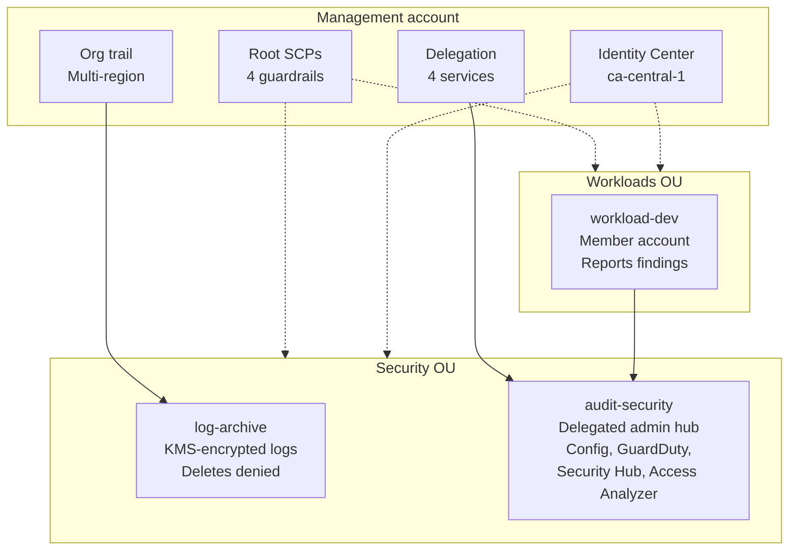

# Secure Multi-Account AWS Landing Zone

A multi-account AWS foundation built entirely in Terraform: preventive guardrails, tamper-resistant centralized logging, and organization-wide detective controls managed from a dedicated security account.

## Architecture

## What it builds

- **Organization:** 3 OUs (Security, Infrastructure, Workloads) and 3 member accounts.
- **Preventive controls (SCPs):** deny CloudTrail tampering, deny Config tampering, restrict to approved regions, deny root user actions.
- **Logging:** organization CloudTrail with log file validation, delivered to a versioned, KMS-encrypted bucket in a separate log-archive account. A bucket policy denies object deletion for all principals.
- **Detective controls:** AWS Config (recorders in all 4 accounts plus an org aggregator), GuardDuty, Security Hub (FSBP and CIS v1.4.0), and IAM Access Analyzer (external access), all administered from audit-security.
- **Access:** IAM Identity Center for humans and Terraform. No static access keys.
- **CI:** Checkov scans every push via GitHub Actions (report-only).

## Validation

| Control | Result |
|---|---|
| CloudTrail tamper SCP | Live test: explicit deny from a member account |
| Region restriction SCP | Live test: explicit deny in eu-west-1, same call succeeded in us-east-1 |
| Root-deny SCP | Verified by policy review and attachment, not live-tested |
| Log integrity | `validate-logs`: 27/27 digest files valid, 220/220 log files valid |
| Security Hub | 3 members Enabled, FSBP and CIS v1.4.0 READY |
| Config aggregator | All 4 accounts and the organization SUCCEEDED |

## Design decisions

- **Separate log-archive account:** a compromised workload or admin role in another account cannot reach the evidence.
- **Delegated administration:** security tooling runs from audit-security so the management account stays minimal.
- **Flat Terraform first:** modules only where repetition justified it (Config recorders).
- **Remote state:** S3 backend with native locking.
- **Identity Center over IAM users:** the bootstrap IAM user's access key was deleted after migration. Break-glass is the root user with MFA.

## Deploy

1. Create an AWS Organization and enable IAM Identity Center.
2. Configure an SSO profile named `landingzone-sso`.
3. Create the S3 state bucket and update the backend block.
4. Run `terraform init`, `terraform plan`, `terraform apply`.

## Known gaps and future improvements

- Root-deny SCP not live-tested (needs member-account root credentials).
- Checkov findings deferred: cross-region log replication, CloudTrail SNS notifications, S3 access logging, S3 event notifications, CloudTrail to CloudWatch integration.
- Checkov flags `*` resources in the KMS key policy. This is AWS's required root-delegation pattern, not a gap.
- The audit-security Config recorder is defined separately from the shared module.
- A legacy CIS 1.2.0 standard is enabled in one account outside Terraform (drift).
- Member accounts' default Security Hub standards may not include CIS.

## Lessons learned

- Organization trails need bucket grants for both `AWSLogs/<account-id>/` and `AWSLogs/<org-id>/` paths.
- KMS, CloudTrail and S3 permission chains need AWS's exact documented policy shapes.
- Circular dependencies are fixed by hardcoding known values instead of live references.
- Console-side changes cause drift and must be reconciled into code.
- Service-linked roles can need a retry after creation (eventual consistency).
- Identity Center API calls must use its home region.
- SCPs never apply to the management account.